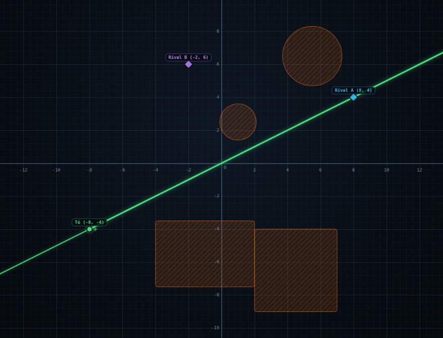

# Trazador

Plano cartesiano interactivo para **planear tiros** en juegos tipo Roblox donde escribes una
ecuación y la bala sigue esa curva. Todo el cálculo y el dibujo ocurren en el navegador:
no hay servidor, no hay dependencias y no se conecta a ninguna partida.



## Abrir

- Doble clic en `index.html` (funciona sin servidor), o
- `python3 -m http.server 8000` dentro de esta carpeta y abrir <http://localhost:8000>.

## Qué hace

| | |
|---|---|
| **Tu posición** | Punto verde arrastrable, con coordenadas editables a mano. |
| **Rivales** | Diamantes con nombre, X/Y; cada fila muestra la distancia y el ángulo desde ti. El botón ◎ traza una recta exacta hasta ese rival. |
| **Obstáculos** | Muros (rectángulos) y rocas (círculos). Se colocan con la barra superior, se mueven y se estiran con los tiradores. |
| **Ecuación** | Se escribe arriba y se dibuja al instante. Cualquier letra que uses (`m`, `b`, `a`, `h`…) se convierte en un **deslizador** para moverla en tiempo real. |
| **Mover a mano** | Agarra la curva con el mouse y arrástrala: se recalcula todo mientras la mueves. |
| **Choques** | Si la trayectoria toca un obstáculo, se marca en rojo con el punto exacto, la distancia y el tiempo. |
| **Disparo** | «Disparar» (o `D`) anima la bala hasta el primer choque. |
| **Escena** | Se guarda sola en el navegador. Guardar/Cargar `.json` para llevarla a otro lado. |

## Sintaxis de las ecuaciones

```
0.5*x                 recta
m*x + b               recta con deslizadores m y b
a*(x - h)^2 + k       parábola
A*sin(w*x)            onda
sqrt(x + 16)          raíz        (solo x ≥ -16)
0.02*x^3 - x          cúbica
2x + 1                multiplicación implícita
```

Operadores `+ - * / ^`, funciones `sin cos tan asin acos atan sqrt abs ln log log2 exp floor ceil round sign min max`,
constantes `pi`, `e`. Los decimales van con **punto** (`0.5`, no `0,5`).

## Atajos

| Tecla | Acción |
|---|---|
| `D` | Disparar |
| `F` | Encuadrar todo |
| `G` | Rejilla |
| `V` | Volver al modo selección |
| `P` | Colocar mi punto |
| `+` / `-` | Zoom |
| Flechas | Mover lo seleccionado (`Shift` = pasos finos) |
| `Supr` | Borrar lo seleccionado |
| `Esc` | Cancelar / deseleccionar |
| Rueda | Zoom; arrastrar el fondo = mover la vista |

## Nota sobre Roblox

Una página web **no puede leer** la posición de tu personaje dentro de una partida de Roblox
(no existe forma de conectarse al juego desde el navegador). Copia tus coordenadas a mano:
con dos o tres puntos y los obstáculos principales ya tienes una escena muy fiel para calcular el tiro.

## Archivos

- `index.html` — estructura y paneles.
- `styles.css` — diseño.
- `app.js` — lienzo, arrastre, colisiones, bala, estado y guardado.
- `parser.js` — evaluador de expresiones propio (sin `eval`, con multiplicación implícita).
